# Arogya Karnataka — entity relationship diagram

This diagram focuses on ownership and data separation. Each database table, index, and foreign key is defined in `src/db/schema.ts`.

```mermaid
erDiagram
  HOSPITALS ||--o{ DEPARTMENTS : contains
  HOSPITALS ||--o{ USERS : employs
  HOSPITALS ||--o{ PATIENTS : registers
  HOSPITALS ||--o{ BEDS : operates
  HOSPITALS ||--o{ LABORATORY_TESTS : offers
  HOSPITALS ||--o{ PHARMACY_INVENTORY : stocks
  ROLES ||--o{ USERS : assigns
  ROLES ||--o{ ROLE_PERMISSIONS : grants
  PERMISSIONS ||--o{ ROLE_PERMISSIONS : grants
  DEPARTMENTS ||--o{ DOCTORS : serves
  DEPARTMENTS ||--o{ STAFF : serves
  USERS ||--o| DOCTORS : profile
  USERS ||--o| STAFF : profile
  HEALTH_DISTRICTS ||--o{ PATIENTS : residence
  USERS ||--o{ PATIENTS : registers
  USERS ||--o| PATIENTS : owns_optional_portal_link
  PATIENTS ||--o{ MEDICAL_HISTORY : history
  PATIENTS ||--o{ ALLERGIES : allergies
  PATIENTS ||--o{ APPOINTMENTS : schedules
  DEPARTMENTS ||--o{ APPOINTMENTS : routes
  DOCTORS ||--o{ APPOINTMENTS : clinician
  APPOINTMENTS ||--o{ CONSULTATIONS : results_in
  PATIENTS ||--o{ CONSULTATIONS : attends
  DOCTORS ||--o{ CONSULTATIONS : authors
  PATIENTS ||--o{ VITAL_SIGNS : observes
  CONSULTATIONS ||--o{ VITAL_SIGNS : records
  CONSULTATIONS ||--o{ REFERRALS : creates
  PATIENTS ||--o{ REFERRALS : referred
  DISEASES ||--o{ DISEASE_DATASETS : studies
  DISEASES ||--o{ ML_MODELS : separates
  DISEASES ||--o{ ML_PREDICTIONS : receives
  ML_MODELS ||--o{ ML_PREDICTIONS : optionally_uses
  USERS ||--o{ ML_PREDICTIONS : records_deidentified_intake
  PATIENTS ||--o{ LABORATORY_REPORTS : tested
  LABORATORY_TESTS ||--o{ LABORATORY_REPORTS : defines
  USERS ||--o{ LABORATORY_REPORTS : orders
  PATIENTS ||--o{ PRESCRIPTIONS : prescribed
  CONSULTATIONS ||--o{ PRESCRIPTIONS : supports
  USERS ||--o{ PRESCRIPTIONS : authors
  PRESCRIPTIONS ||--o{ PRESCRIPTION_ITEMS : contains
  MEDICATIONS ||--o{ PRESCRIPTION_ITEMS : dispenses
  MEDICATIONS ||--o{ PHARMACY_INVENTORY : stocked_as
  BEDS ||--o{ ADMISSIONS : allocated
  PATIENTS ||--o{ ADMISSIONS : admitted
  ADMISSIONS ||--o| DISCHARGES : discharged_by
  PATIENTS ||--o{ PREGNANCY_RECORDS : pregnancy
  PREGNANCY_RECORDS ||--o{ ANTENATAL_VISITS : antenatal
  PREGNANCY_RECORDS ||--o| MATERNAL_DELIVERIES : delivery
  PREGNANCY_RECORDS ||--o{ POSTNATAL_VISITS : postnatal
  HEALTH_DISTRICTS ||--o{ DISTRICT_HEALTH_INDICATORS : aggregate_only
  PATIENTS ||--o{ BILLINGS : charged
  HOSPITALS ||--o{ BILLINGS : issues
  BILLINGS ||--o{ PAYMENTS : paid_by
  USERS ||--o{ AUDIT_LOGS : actor
```

## Table catalogue

| Domain | Normalized tables |
|---|---|
| Identity & access | `users`, `roles`, `permissions`, `role_permissions`, `doctors`, `staff` |
| Hospital operations | `hospitals`, `departments`, `beds`, `admissions`, `discharges`, `laboratory_tests`, `laboratory_reports`, `medications`, `pharmacy_inventory`, `prescriptions`, `prescription_items`, `billings`, `payments` |
| Patient care | `patients`, `medical_history`, `allergies`, `appointments`, `consultations`, `vital_signs`, `referrals` |
| Maternal/newborn | `pregnancy_records`, `antenatal_visits`, `maternal_deliveries`, `postnatal_visits` |
| Disease-model research | `diseases`, `disease_datasets`, `ml_models`, `ml_predictions` |
| Aggregate public health | `health_districts`, `district_health_indicators` |
| Accountability | `audit_logs` |

District indicators are keyed to district, source, and survey period. They do not join to patient identity. A model's dataset, version, artifact, and metrics are condition-specific. The current research intake stores feature-only fields with no patient foreign key, no model, no category, and no probability.
